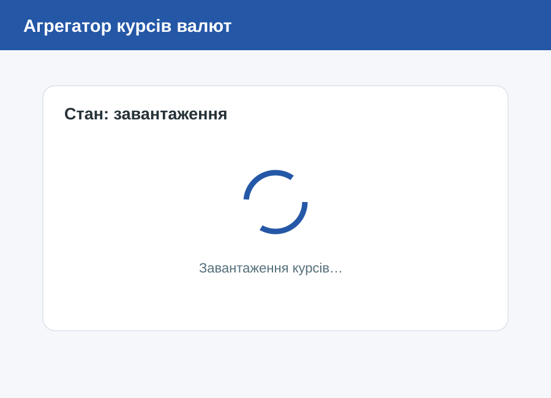
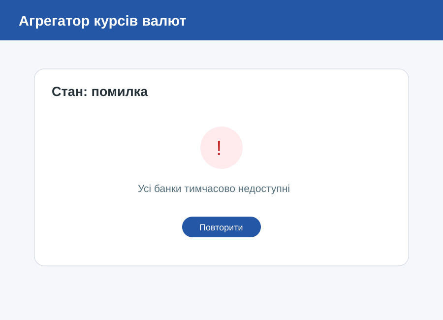
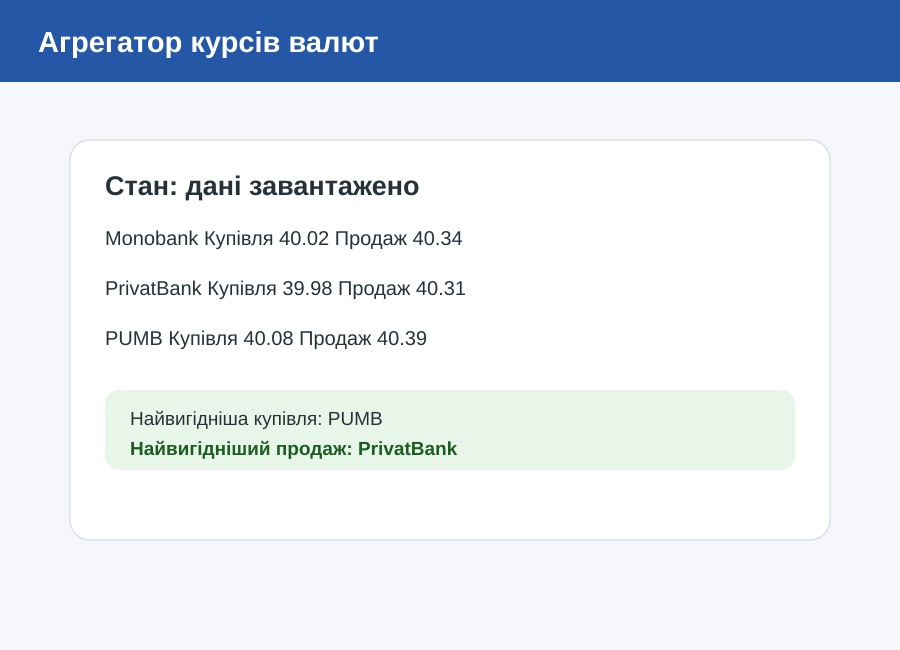
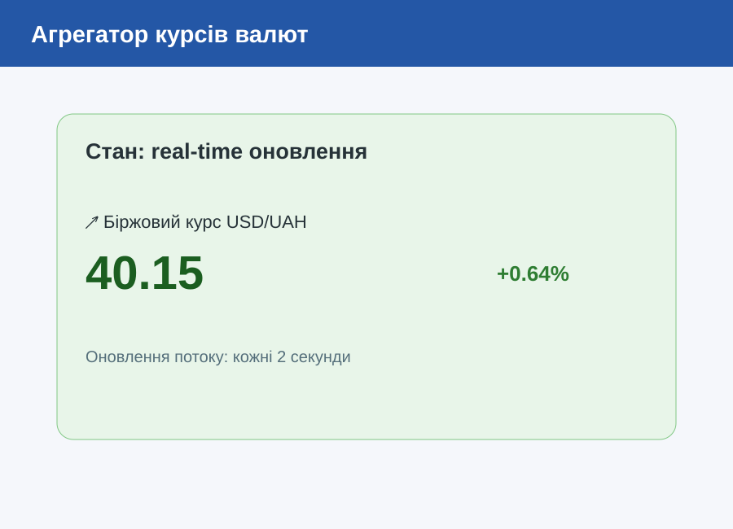

# Практична робота 8 — Варіант 3: Агрегатор курсів валют

**Дисципліна:** Програмування для мобільних платформ
**Тема:** Робота з асинхронним кодом в Dart
**Студент:** Сергієнко Максим, група alk43

## Опис

Flutter-застосунок порівнює курси трьох імітованих банків (Monobank, PrivatBank, PUMB) і показує біржовий курс USD/UAH у реальному часі. Мережа імітується через `Future.delayed` у сервісі `FakeRatesService`, справжні HTTP-запити не використовуються. Частота збоїв задається параметром `failureRate`.

## Запуск

```bash
flutter pub get
flutter run
flutter analyze
```

Потрібні Flutter 3.x та Dart 3.x. Частота збоїв задається в `lib/main.dart`: `FakeRatesService(failureRate: 0.15)`. Для демонстрації часткової недоступності встановіть `0.5`.

## Де що реалізовано

| Вимога | Місце в коді |
|---|---|
| Паралельне завантаження трьох банків, `Future.wait` | `lib/services/fake_rates_service.dart` → `loadAllRates()` |
| Помилка одного банку не скасовує інші | `loadAllRates()` — кожен банк обгорнутий у `try/catch`, повертає `null` |
| «Найшвидше джерело», `Future.any` | `fetchFastest()` |
| Тайм-аут 3 с і до 3 повторних спроб з експоненційною затримкою | `fetchWithRetry()` (`.timeout`, затримка 250·2^n мс) |
| Потік біржового курсу кожні 2 с (`StreamController.broadcast`) | `exchangeStream` |
| `where` — відбір змін понад 0,5 %, `map` — обчислення відсотка | `exchangeStream` |
| `dispose()`: таймер і контролер | `FakeRatesService.dispose()`, викликається з `_RatesAppState.dispose()` у `lib/main.dart` |
| `FutureBuilder`: завантаження / дані / помилка з «Повторити» / порожньо | `lib/screens/rates_screen.dart` |
| `StreamBuilder` з підсвічуванням зміни | `lib/screens/rates_screen.dart` → `_ExchangeCard` |
| Pull-to-refresh | `RefreshIndicator` у `RatesScreen` |
| Перевірка `mounted` після `await` | `_findFastest()`, `_reload()` |
| Future для `FutureBuilder` не створюється в `build()` | створюється в `initState()` і `_reload()` |

## Вимірювання часу

Паралельний час береться з рядка «Паралельне завантаження: … мс» під списком банків. Послідовний час виміряно тим самим сервісом, якщо викликати банки по черзі (`await` у циклі).

| Запуск | Послідовно, мс | Паралельно (`Future.wait`), мс |
|---:|---:|---:|
| 1 | 2708 | 1124 |
| 2 | 3167 | 1286 |
| 3 | 2439 | 978 |

Через повтори й імітовані збої час може бути більшим.

## Скриншоти станів

| Завантаження | Помилка з «Повторити» |
|---|---|
|  |  |

| Порожньо | Дані |
|---|---|
|  |  |

Оновлення в реальному часі:



## Структура

```
lib/
  main.dart                       # запуск, створення та dispose сервісу
  models/bank_rate.dart           # BankRate, ExchangeQuote, RateLoadResult
  services/fake_rates_service.dart
  screens/rates_screen.dart
docs/                             # скриншоти станів
```

## Що показати на захисті

1. Запуск: індикатор завантаження, дані, оновлення біржового курсу.
2. «Найшвидше джерело» — пояснити `Future.any`.
3. Pull-to-refresh.
4. `failureRate: 0.5` — недоступні банки позначені, решта даних видно.
5. Вихід із застосунку під час оновлення — без помилок у консолі (`dispose()`).
